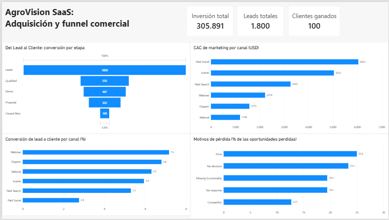
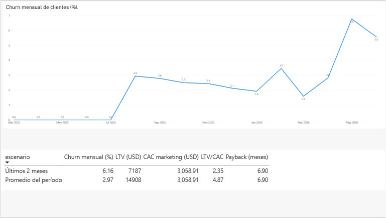
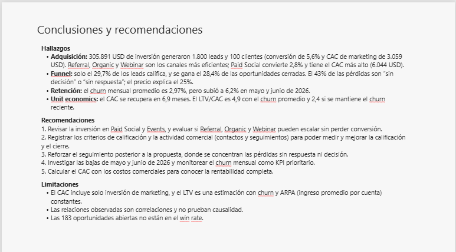

# AgroVision SaaS: análisis comercial y de clientes

Caso de portfolio sobre una empresa B2B de software para el agro (**datos sintéticos**, USD, enero 2025 a junio 2026). Recorre el ciclo comercial completo: adquisición, funnel de ventas, churn y unit economics.

## Problema de negocio

¿Cuánto cuesta adquirir clientes, cómo avanza el funnel comercial, cuánto se pierde por churn y si el negocio es rentable por cliente (LTV/CAC)?

## Datos y herramientas

- 7 CSV (leads, opportunities, accounts, marketing_campaigns, product_usage_monthly, sales_reps y subscriptions_monthly), en la carpeta `data/`.
- **SQLite** (en memoria, cargado con pandas) para todo el análisis, en un notebook de Kaggle.
- **Power BI** para el dashboard de 3 páginas (los 5 CSV exportados del notebook están en `data/powerbi/`).

## Cómo está organizado el repositorio

- `notebook/`: notebook con las consultas SQL, la validación de datos y las conclusiones.
- `data/`: CSV originales, sin modificar.
- `data/powerbi/`: tablas resumen exportadas del notebook para el dashboard.
- `powerbi/`: archivo `.pbix` y versión en PDF del dashboard.
- `images/`: capturas del dashboard.

## Dashboard

Versión legible en PDF: [AgroVision_dashboard.pdf](powerbi/AgroVision_dashboard.pdf)

## Principales resultados

Todas las cifras salen de consultas visibles en el notebook.

- **Adquisición:** 1.800 leads con una inversión de marketing de USD 305.891 (CPL USD 169,94).
- **Funnel:** win rate de 28,41% (ganadas / (ganadas + perdidas), excluyendo las oportunidades abiertas). El notebook detalla las etapas, los motivos de pérdida, el ciclo de venta y el MRR potencial no concretado.
- **Churn:** 20 cuentas dadas de baja entre agosto de 2025 y junio de 2026, sin reactivaciones. Churn mensual promedio ponderado de 2,97%, y 6,16% en los últimos dos meses.
- **Economía unitaria (estimada):** ARPA (ingresos por cuenta promedio mensual) de USD 554,51 y margen bruto de 79,89%.

| Escenario de churn | LTV (USD) | LTV/CAC | Payback (meses) |
|---|---|---|---|
| Promedio del período (2,97%) | 14.908 | 4,87 | 6,9 |
| Últimos 2 meses (6,16%) | 7.187 | 2,35 | 6,9 |

## Recomendaciones

1. Revisar la inversión en Paid Social y Events, y evaluar si Referral, Organic y Webinar pueden escalar sin perder conversión.
2. Registrar los criterios de calificación y la actividad comercial (contactos y seguimientos) para poder medir y mejorar la calificación
y el cierre.
3. Reforzar el seguimiento posterior a la propuesta, donde se concentran las pérdidas sin respuesta ni decisión.
4. Investigar las bajas de mayo y junio de 2026 y monitorear el churn mensual como KPI prioritario.
5. Calcular el CAC con los costos comerciales para conocer la rentabilidad completa

## Limitaciones y criterios de análisis

- **Datos sintéticos:** los resultados ilustran la metodología y no representan a una empresa real.
- **CAC de marketing:** incluye solo la inversión en marketing, no los costos del equipo comercial, por lo que no es un CAC totalmente cargado.
- **LTV estimado:** se calcula como ARPA × margen / churn, suponiendo churn y ARPA constantes. Extrapola más allá de la ventana de 17 meses disponible, y por eso se muestran dos escenarios.
- **Churn:** se cuenta una baja por cuenta, en el primer mes con estado "Churned". Las cuentas dadas de baja siguen apareciendo con MRR 0.
- **72 oportunidades con ID `P`:** (47 perdidas y 25 abiertas) no corresponden a cuentas de la tabla `accounts`. Se tratan como prospectos sin cuenta en el análisis, sin modificar el CSV de origen.
- **6 cuentas sin suscripción:** su alta es posterior a junio de 2026, fuera de la ventana de datos. No entran en las métricas de suscripción.
- **Alcance:** análisis descriptivo. No hay modelos predictivos ni afirmaciones de causalidad.

## Cómo reproducirlo

1. Abrir el notebook en Kaggle o en Jupyter.
2. Ajustar `DATA_PATH` a la carpeta con los 7 CSV. En Kaggle es la ruta del dataset, y en local, la carpeta `data/` de este repositorio.
3. Ejecutá las celdas en orden. La última celda exporta los CSV para Power BI.
